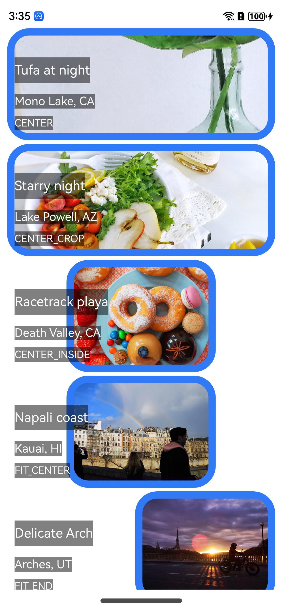
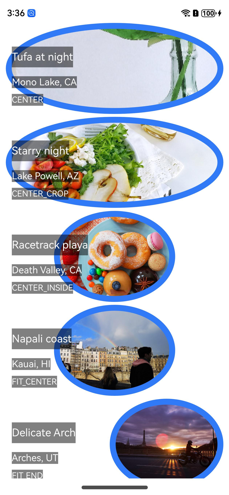
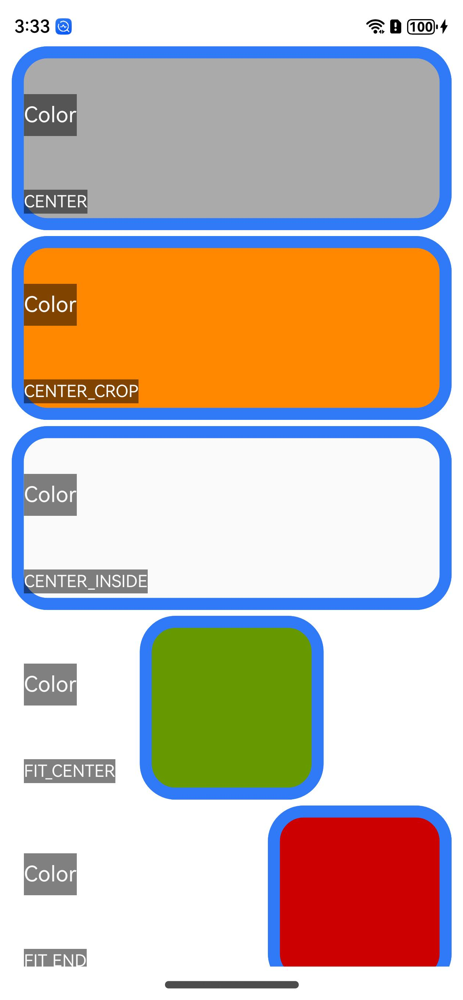
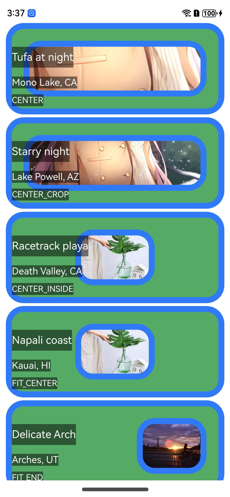
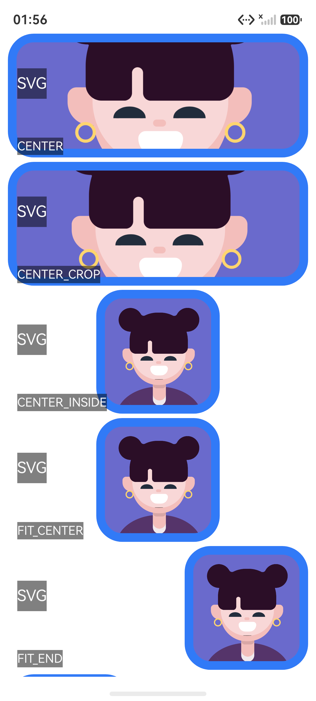

<div align="center">
<h1>rounded-image-view-cj</h1>
</div>

<p align="center">


</p>

## 介绍

rounded-image-view-cj支持圆角（和椭圆或圆形）的快速 ImageView。

它支持许多附加功能，包括椭圆、圆角矩形、ScaleTypes 和 TileModes。

### 特性

1. 支持图片显示为圆角矩形并带边框
2. 支持图片显示为椭圆并带边框
3. 支持Color类型显示并带边框
4. 支持Background类型显示并带边框
5. 支持SVG图片显示并带边框
6. 支持设置ScaleType七种缩放类型
7. 支持设置TileMode三种背景平铺类型
8. 支持路径uri、media、本地rawfile、网络url等相关数据绘制

## 软件架构

### 源码目录

```shell
├─AppScope
├─doc
├─entry
│  └─src
│      └─main
│          ├─cangjie
│          └─resources
├─roundedimageview
│  └─src
│      └─main
│          ├─cangjie
│          └─resources
├─scripts
└─hvigor

```

- `AppScope` 全局资源存放目录和应用全局信息配置目录
- `doc` API文档和使用手册存放目录
- `entry` 工程模块 - 编译生成一个HAP
- `entry src` APP代码目录
- `entry src main` APP项目目录
- `entry src main cangjie` 仓颉代码目录
- `entry src main resources` 资源文件目录
- `roundedimageview` 工程模块 - 编译生成一个har包
- `roundedimageview src` 模块代码目录
- `roundedimageview src main` 模块项目目录
- `roundedimageview src main cangjie` 仓颉代码目录
- `roundedimageview src main resources` 资源文件目录
- `scripts` 预编译依赖下载脚本目录
- `hvigor` 构建工具目录

### 接口说明

主要类和函数接口说明详见 [API](doc/feature_api.md)

## 使用说明

### 编译构建

roundedimageview 依赖预编译产物 `roundedimageview/har/svg.har`（超过仓库大小限制不入库）。工程根目录 `oh-package.json5` 已配置 `hooks.preInstall`，执行 `ohpm install` 时会自动运行 `scripts/pre_har_install.mjs` 下载并做 SHA256 校验，也可手动执行 `node ./scripts/pre_har_install.mjs` 补齐。

1. 通过module引入
    1. 克隆下载项目
    2. 将roundedimageview模块拷贝到应用项目下
    3. 修改自身应用 entry 下的 oh-package.json5 文件，在 dependencies 字段添加 "@cangjie-tpc/roundedimageview": "file:../roundedimageview"
       ```json
       {
          "name": "entry",
          "version": "1.0.0",
          "description": "Please describe the basic information.",
          "main": "",
          "author": "",
          "license": "",
         "dependencies": {
             "@cangjie-tpc/roundedimageview": "file:../roundedimageview"
         }
       }
       ```
    4. 在项目中使用 import roundedimageview.* 引用roundedimageview项目
       ```cangjie
       import roundedimageview.*
       ```

### 功能示例

```cangjie

@Entry
@Component
class TestExamples {
    func build() {
        Scroll() {
            RoundedImageView(model: getRoundedImageViewModel())
        }
    }

    func getRoundedImageViewModel(): RoundedImageNameModel {
        let roundedImageNameModel: RoundedImageNameModel = RoundedImageNameModel()
            // 设置图片
            .setImageSrc(@r(app.media.photo1))
            // 设置背景颜色
            .setBackgroundColor(Color(0x55AA66))
            // 设置图片类型
            .setSrcType(SrcType.MEDIA)
            // 图片是不是SVG图片
            .setIsSvg(false)
            // 显示类型
            .setTypeValue(ImgValueType.IMG_VALUE_BITMAP)
            // 设置图片显示的宽度
            .setUiWidth(100.0)
            // 设置图片显示的高度
            .setUiHeight(100.0)
            // 设置图片缩放类型
            .setScaleType(ScaleType.CENTER)
            // 设置图片的重复样式
            .setTileModeXY(TileMode.REPEAT)
            // 设置角半径
            .setCornerRadius(10.0)
            // 设置边框线宽
            .setBorderWidth(5.0)
            // 设置边框线颜色
            .setBorderColor(Color(0x317AF7))
            // 设置图片内边距
            .setPadding(0.0)
            // 颜色宽度
            .setColorWidth(100.0)
            // 颜色高度
            .setColorHeight(100.0)
            // 设置上下文
            .setContext(GlobalContext.getContext().getUIAbilityContext().getOrThrow())
        return roundedImageNameModel
    }
}
```

使用前需在 UIAbility 的 `onCreate` 中注册上下文：`GlobalContext.getContext().setUIAbilityContext(context)`。

SVG图片示例（依赖[svg4cj](https://gitcode.com/Cangjie-TPC/svg4cj)，支持media、rawfile、uri、url、arraybuffer数据源）：

```cangjie
func getSvgViewModel(): RoundedImageNameModel {
    let roundedImageNameModel: RoundedImageNameModel = RoundedImageNameModel()
        // 设置SVG图片（rawfile路径，网络图片则传入url并设置SrcType.URL）
        .setImageSrc("ic_svg.svg")
        // 设置图片类型
        .setSrcType(SrcType.RAWFILE)
        // 图片是不是SVG图片
        .setIsSvg(true)
        // 显示类型
        .setTypeValue(ImgValueType.IMG_VALUE_SVG)
        // 设置图片显示的宽度
        .setUiWidth(300.0)
        // 设置图片显示的高度
        .setUiHeight(300.0)
        // 设置图片缩放类型
        .setScaleType(ScaleType.FIT_CENTER)
        // 设置角半径
        .setCornerRadius(25.0)
        // 设置边框线宽
        .setBorderWidth(10.0)
        // 设置边框线颜色
        .setBorderColor(Color(0x317AF7))
        // 设置上下文
        .setContext(GlobalContext.getContext().getUIAbilityContext().getOrThrow())
    return roundedImageNameModel
}
```

### 预览效果











## 约束与限制

当前基于 DevEco Studio for Windows 6.1.1 版本实现的

1. SVG图片依赖 [svg4cj](https://gitcode.com/Cangjie-TPC/svg4cj) v2.0.0（`svg_6.1.1-v2.0.0.har`），由 `scripts/pre_har_install.mjs` 在 `ohpm install` 前自动下载并做 SHA256 校验

## 开源协议

本项目基于 [Apache License 2.0](./LICENSE) ，请自由的享受和参与开源。

## 参与贡献

欢迎给我们提交PR，欢迎给我们提交Issue，欢迎参与任何形式的贡献。